# Lumio – Interactive Website with JavaScript

**ApexLark Full Stack Development Internship – Day 04 Task**
**Topic:** JavaScript Fundamentals & DOM Manipulation
**Intern:** _Your Name_ &nbsp;|&nbsp; **Date:** 05 November 2026

---

## Project Title

**Lumio – "Meetings that write themselves"** (interactive version)

## Objective

To take the Lumio landing page from Day 3 and make it interactive with **plain JavaScript (ES6)**. The script uses:
- variables, arrow functions, arrays, objects and loops;
- DOM manipulation;
- event handling;
- form validation.

All the JavaScript lives in one external, commented file: `js/script.js`.

## Business Scenario

NovaByte Solutions (a fictional Bengaluru startup) is launching **Lumio**, an AI meeting assistant. The website now:
- greets visitors based on the time of day;
- shows a live clock and random quotes;
- reacts to clicks, double-clicks, hovers and key presses;
- lets new users register through a form that checks every field without reloading the page.

## Design

| Colour | Hex | Used for |
|--------|-----|----------|
| Midnight Black | `#0B0B0F` | Background (dark theme), text (light theme) |
| Pure White | `#FFFFFF` | Text (dark theme), background (light theme), cards |
| Golden Yellow | `#FFC300` | Buttons, highlights, tunnel rings, progress bars |

- **Fonts:** *Lora* for headings and *Poppins* for text, from Google Fonts.
- **Styling:** plain CSS with CSS variables, so the dark and light themes switch by changing one attribute.
- **Libraries:** none. There is no Bootstrap and no jQuery.

## Features

### Required mini features
| Feature | How it works |
|---------|--------------|
| **Dark / light theme toggle** | The sun/moon button (or the **T** key) changes `data-theme` on `<html>`. The choice is saved in `localStorage`. |
| **Digital clock + greeting** | Updates every second with `setInterval`. A `switch` statement picks *Good morning / afternoon / evening / night*, shown in the hero, the header and the clock card. It also has a 12/24-hour button and a "how much of today has passed" bar. |
| **Responsive navigation menu** | Below 992 px the hamburger opens a slide-in menu. The icon changes to ✕ and `aria-expanded` updates. The menu closes on a link click, on **Escape**, or on a click outside. The current section's link is highlighted. |
| **Random quote generator** | Ten quotes are stored in an array of objects. Each new quote is always different from the last, with a fade animation. Use **Like** or **double-click** to save a favourite; the favourite count is shown. The **Q** key also gives a new quote. |
| **Character counter** | The "About your team" textarea shows `0 / 200` and a progress bar. The counter turns gold at 80% and red at the limit. |

### Registration form validation
| Field | Rule | Example error message |
|-------|------|-----------------------|
| Full Name | Required, at least 3 letters, letters and spaces only | "Use at least 3 letters (letters and spaces only)." |
| Email | Required, valid format `name@domain.com` (regex) | "That doesn't look like a valid email…" |
| Phone | Required, 10 digits, starts with 6–9 (Indian mobile) | "Phone number must be 10 digits (you typed 5)." |
| Password | Required, at least 8 characters, with a strength meter | "Password must be at least 8 characters (3 more to go)." |
| Confirm Password | Required, must match the password | "Passwords do not match." |

- Fields are checked **while you type** (`input` event) and again **on submit**.
- `event.preventDefault()` stops the page from reloading.
- If any field is invalid:
  - the first wrong field gets focus;
  - the card shakes;
  - a message says how many fields need fixing.
- The checklist beside the form ticks off each rule as it is met.
- Buttons inside the password fields show or hide the password.
- The phone field blocks letters as you type (`keypress`) and removes them from pasted text.
- On success:
  - the form is hidden and a welcome message appears, using the user's first name;
  - the form is cleared;
  - "Register another person" brings the form back.

### Extra interactions
- **Service cards** are built from an array:
  - **mouseover** highlights a card and shows more detail;
  - **mouseleave** resets it;
  - **double-click** pins a card.
- **Pricing** cards are built from objects, with a **Monthly / Yearly** switch.
- **FAQ** is built from an array and opens or closes on click (show/hide with the `hidden` attribute).
- **Counters** count up when they scroll into view; sections fade in as you scroll.
- **Scroll progress bar**, a header that turns solid on scroll, a **toast** message helper, and a **typing effect** in the hero.
- **Hero: 3D golden tunnel.** Scrolling flies you through spinning gold rings and floating cards.
  - The mouse tilts the tunnel.
  - A `<canvas>` draws golden "warp speed" dust, which flies faster the faster you scroll.

## JavaScript Concepts Used

| Concept | Where in `script.js` |
|---------|----------------------|
| `const` / `let` | Throughout (no `var`) |
| **Arrow functions** | Every function, e.g. `const pad = (num) => String(num).padStart(2, "0");` |
| **Arrays** | `quotes`, `companies`, `stats`, `services`, `plans`, `faqs`, `audiences` |
| **Objects** | Every quote, plan, service and FAQ is an object; also the `validators` and `storage` helpers |
| **Loops** | `for` (dust particles), `for...of` (tunnel items, sections), `forEach`, `do...while` (picking a new quote) |
| **Array methods** | `map` + `join` (render HTML), `filter` (password score), `every` (form valid?), `find` (first invalid field), `includes` |
| **Template literals** | All generated HTML and messages |
| **Destructuring** | `const { text, author } = quotes[index];` |
| **Spread syntax** | `[...document.querySelectorAll()]`, `[...companies, ...companies]` |
| **Default parameters** | `showToast(message, duration = 2600)` |
| **Ternary operator / switch** | Theme icon, 12/24-hour clock, greeting by hour |
| **Regular expressions** | Name, email and phone validation, password strength |
| **Set** | Liked quotes |
| **Timers** | `setInterval` (clock), `setTimeout` (typing, toast, quote fade) |
| **`requestAnimationFrame`** | 3D tunnel, dust canvas, counters |
| **IntersectionObserver** | Reveal on scroll and counters |
| **localStorage** (inside `try...catch`) | Theme, clock format, liked quotes |

## DOM Manipulation Used

| Task | Examples |
|------|----------|
| Select elements | `querySelector`, `querySelectorAll` (through the short helpers `$` and `$$`) |
| Change text / HTML | `textContent` (clock, greeting, quotes, errors), `innerHTML` (cards built from arrays) |
| Change styles | `element.style.width` (progress bars), `style.transform` and `style.opacity` (3D tunnel) |
| Add / remove classes | `classList.add`, `remove`, `toggle` (theme, menu `.open`, `.is-hovered`, `.is-pinned`, `.valid` / `.invalid`, `.liked`) |
| Show / hide | The `hidden` property (FAQ answers, success box, form, toast, service details) |
| Attributes | `setAttribute` (`data-theme`, `aria-expanded`, `aria-pressed`, `aria-invalid`), `dataset` |
| Create / remove elements | `createElement` + `appendChild` (floating heart), `insertAdjacentHTML` (pin badge), `.remove()` |

## Events Handled

| Event | Where |
|-------|-------|
| `click` | Theme toggle, menu, links, new quote, like, 12/24-hour, pricing switch, FAQ, show password, "Register another person" |
| `dblclick` | Double-click the quote to like it; double-click a service card to pin it |
| `mouseover` | Service cards show details and update the status line |
| `mouseleave` | Service cards reset |
| `keypress` | **Q** = new quote, **T** = switch theme; the phone field blocks non-digits |
| `keydown` | **Escape** closes the mobile menu |
| `input` | Live validation of every field, character counter, phone clean-up |
| `submit` | Form validation with `preventDefault()` (no page reload) |
| `reset` | Clears the messages, colours and strength meter |
| `scroll` / `resize` / `mousemove` | Progress bar, header, active link, tunnel, dust, tilt |

## Folder Structure

```
Day-04-JavaScript/
│
├── index.html            # Page structure (no inline JavaScript)
├── css/
│   └── style.css         # All styles: themes, layout, animations, responsive rules
├── js/
│   └── script.js         # All interactivity, split into small commented sections
├── assets/
│   ├── images/           # Mobile app illustration, avatars
│   └── icons/            # Logo and line icons (sun, moon, menu, close, eye, heart…)
├── screenshots/          # Images used in this README
└── README.md
```

## Setup / How to Run

1. Clone the repository:
   ```bash
   git clone https://github.com/<your-username>/Day-04-JavaScript.git
   ```
2. Open the folder in **Visual Studio Code**.
3. Open `index.html` in **Google Chrome**, or right-click it and choose **Open with Live Server**.
4. Nothing needs to be installed. An internet connection is only used for Google Fonts.
5. Things to try:
   - press **T** and **Q**;
   - double-click the quote;
   - hover over and double-click the service cards;
   - submit the form empty, then fill it in correctly;
   - press `F12`, open the device toolbar and test the mobile menu.

## Screenshots

### Hero (dark theme)
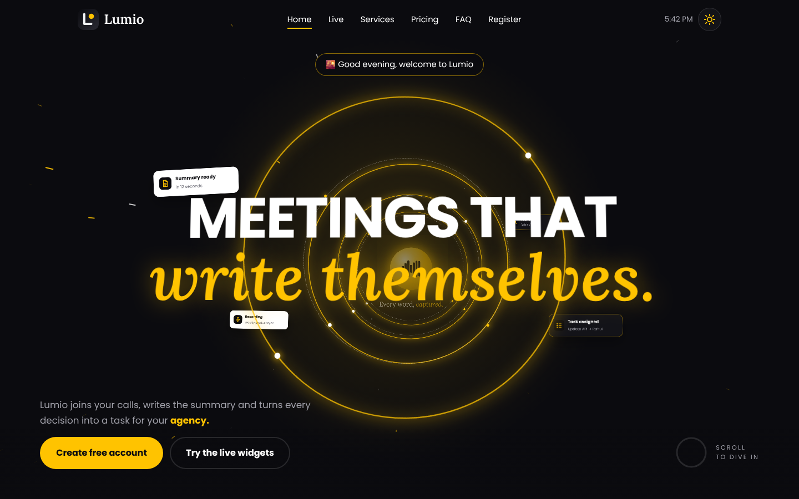

### Scrolling into the 3D tunnel
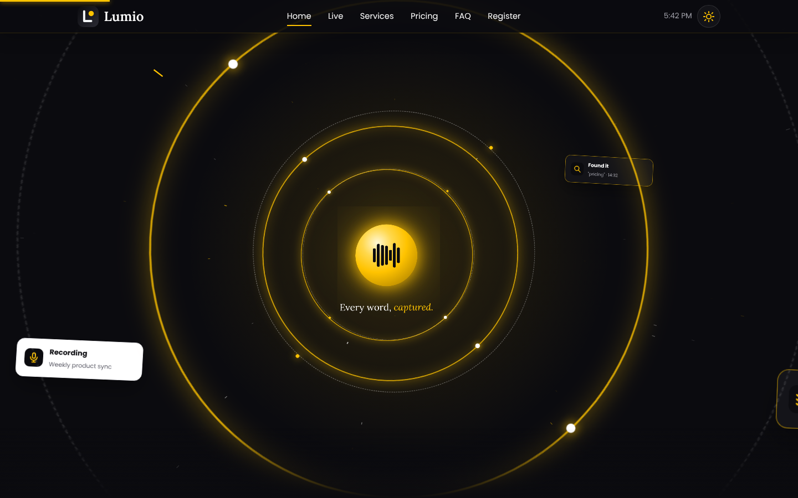

### Light theme
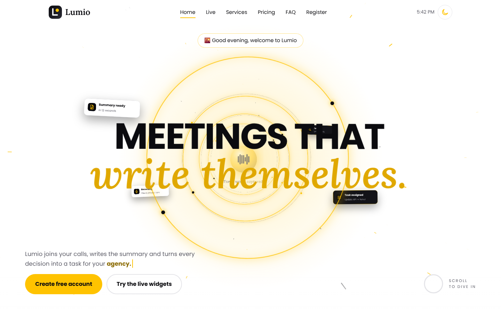

### Live widgets: clock, greeting, quote generator (liked with a double-click), counters
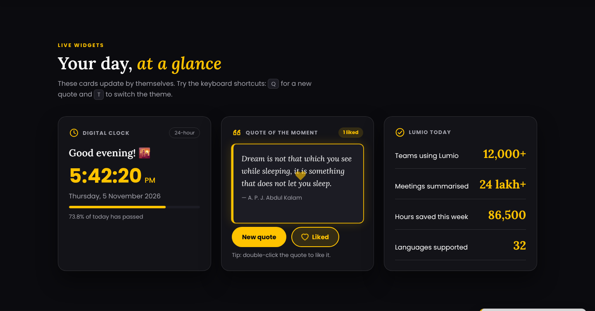

### Services: mouseover shows details, double-click pins a card
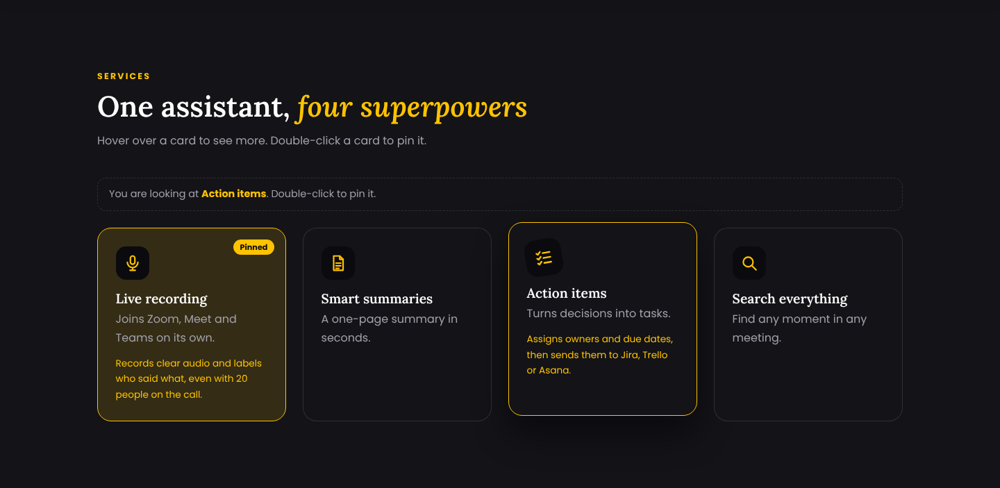

### Form validation
| Errors on submit | All rules met | Success |
|------------------|---------------|---------|
| 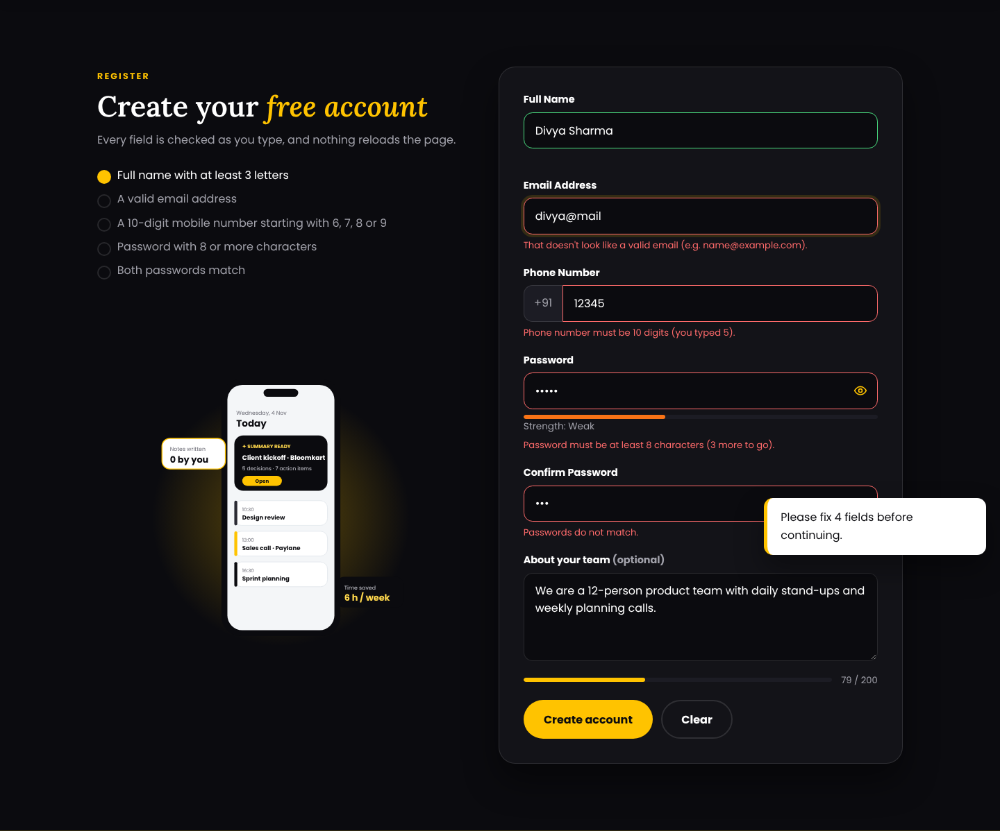 | 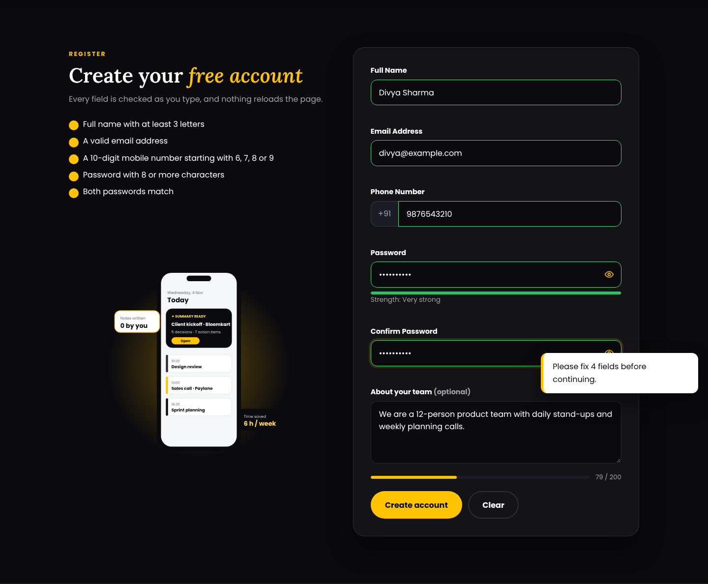 | 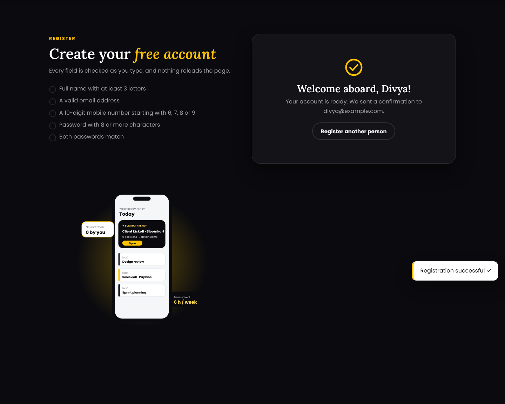 |

### Mobile
| Hero | Navigation menu |
|------|-----------------|
| 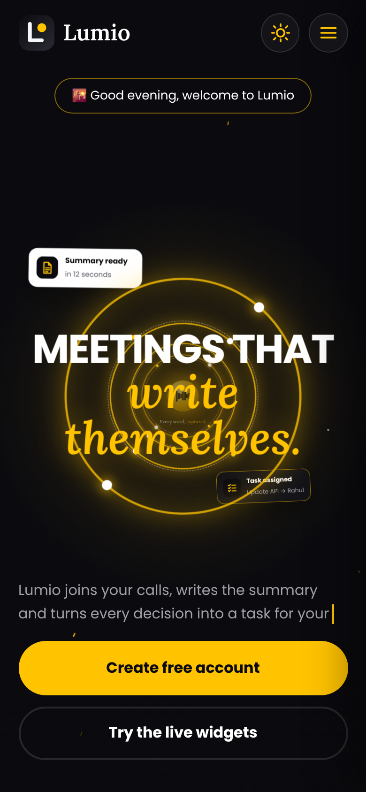 | 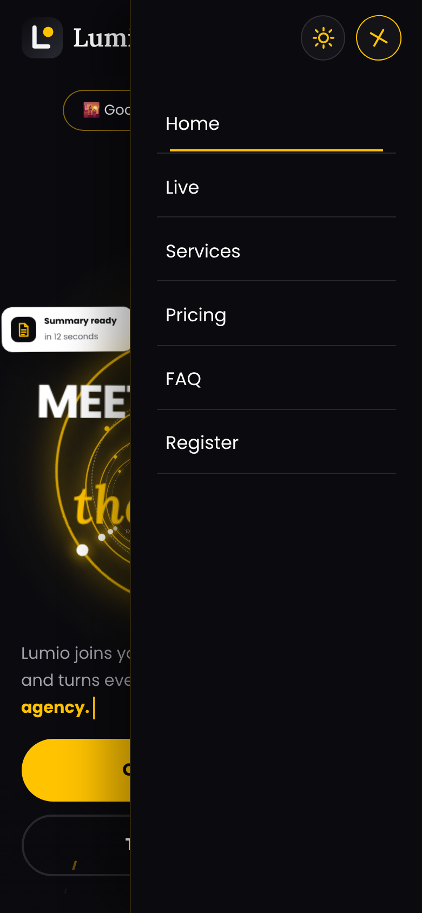 |

<details>
<summary>Full pages (dark, light and mobile)</summary>

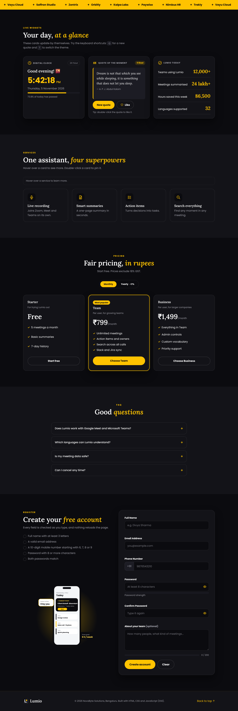
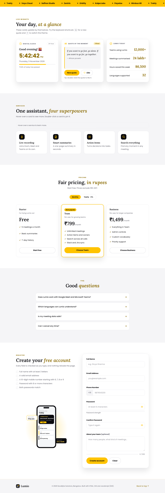

</details>

## Testing

- Every event above was tested in Chrome: click, double-click, mouseover, mouseleave, keypress, input, submit and reset.
- The form was tested with empty, wrong and correct values, and the page never reloads.
- Both themes and three screen widths (mobile 390 px, tablet 820 px, desktop 1440 px) show no horizontal scrolling.
- The DevTools console shows no errors.

## Tools Used
HTML5 · CSS3 · JavaScript (ES6) · Google Fonts · Visual Studio Code · Chrome DevTools · Git & GitHub

## Learning Outcomes
- Wrote modern JavaScript with `const`/`let`, arrow functions, arrays, objects and loops
- Built parts of the page from data with `map()` and template literals
- Changed text, styles, classes and visibility through the DOM
- Handled mouse, keyboard and form events
- Validated a form on the client with regular expressions, without reloading the page
- Kept the code organised in small, commented functions in an external file

---
© 2026 NovaByte Solutions (fictional company created for the ApexLark internship task).
